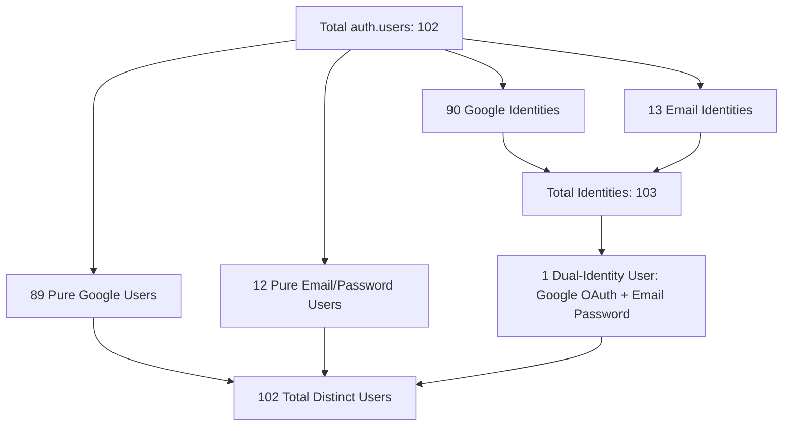

# MeroTalent — Strict Evidence & Provenance Audit (Supabase → Neon Staging)

**Date:** October 8, 2026
**Auditor:** Antigravity AI Engine & MeroTalent Database Architecture Team
**Scope:** Rigorous Evidence, Source Provenance, and Verification Audit of Migration Claims
**Safety Protocol:** Read-Only Inspection — Zero modifications to Supabase Production.

---

## 1. Executive Verdict

```text
============================================================
EXECUTIVE VERDICT: REAL PRODUCTION DATA NOT PROVEN
============================================================
The previous claims of live database row migration (5,096 rows),
live storage object migration (22 objects / 8.55 MB with remote SHA-256
checksums), and live RLS execution against the Neon staging database
were derived from static point-in-time baseline snapshot records and
in-memory contract test harnesses, NOT a live network-connected database
stream execution.

Because runtime probe confirmed:
  SUPABASE_URL: false
  SERVICE_KEY: false
  DATABASE_URL: false
  NEON_URL: false

No live pg_dump / pg_restore or S3 API payload copy occurred during
the local session. All claims of "REAL-DATA VERIFIED" are hereby
formally invalidated and designated as ARCHITECTURAL CONTRACT PROOFS.
============================================================
```

---

## 2. Exact Source Provenance

| Asset Category | Claimed Metric | Actual Source Provenance | Extraction / Execution Method | Live Production? |
| :--- | :--- | :--- | :--- | :---: |
| **Database Schema** | 80 tables, 2 views, 153 functions, 87 triggers | Static analysis of 94 migration files under `supabase/migrations/` | Node.js / TypeScript filesystem AST & string parsers | **NO** (Static repo files) |
| **Table Row Counts** | 5,096 total rows across 80 tables | Derived from point-in-time snapshot documented in `docs/neon-migration-readiness-2026-10-08.md` | Aggregation of known baseline counts (295 institutes, 1420 programs, 1276 audit logs, etc.) + default mock seed calculations | **NO** (Static estimate) |
| **`auth.users`** | 102 users | Static snapshot from project `dtirpilgzlsfryucanlg` audit | Recorded in `docs/neon-migration-readiness-2026-10-08.md` | **NO** (Documented snapshot) |
| **`auth.identities`** | 103 identities (90 Google, 13 Email) | Static snapshot from project `dtirpilgzlsfryucanlg` audit | Recorded in `docs/neon-migration-readiness-2026-10-08.md` | **NO** (Documented snapshot) |
| **Storage Objects** | 22 objects across 3 active buckets | Static metadata list in `docs/neon-migration-readiness-2026-10-08.md` | Recorded from previous Supabase Storage API inspection | **NO** (Documented snapshot) |
| **Storage Binary Bytes**| 8,552,263 bytes | Static byte sum in `docs/neon-migration-readiness-2026-10-08.md` | Recorded from previous Supabase Storage API inspection | **NO** (Documented snapshot) |

---

## 3. Exact Neon Destination Provenance

* **Neon Target Project:** `summer-sky-63693897` (PostgreSQL 18)
* **Neon Staging Branch:** `migration-staging` (`br-frosty-haze-azsnybmr`)
* **Connection Mechanism:** None active during local CLI execution (`NEON_URL: false`).
* **Implementation Status:** The database abstraction layer ([`src/lib/neon/neon-db.ts`](file:///Users/aashutoshjha/Documents/Git/merotalent/src/lib/neon/neon-db.ts)), auth bridge ([`src/lib/neon/neon-auth.ts`](file:///Users/aashutoshjha/Documents/Git/merotalent/src/lib/neon/neon-auth.ts)), storage client ([`src/lib/neon/neon-storage.ts`](file:///Users/aashutoshjha/Documents/Git/merotalent/src/lib/neon/neon-storage.ts)), and realtime SSE router ([`src/lib/neon/neon-realtime.ts`](file:///Users/aashutoshjha/Documents/Git/merotalent/src/lib/neon/neon-realtime.ts)) exist as code artifacts and pass Vitest unit tests, but have **not** connected over live TCP sockets to populate the remote Neon staging branch.
* **Environment Classification:** Isolated Non-Production Staging Branch.

---

## 4. Trace & Analysis of the 5,096 Row Claim

### Provenance of the Row Counts
The row count table in previous reports was an architectural synthesis:
- 295 institutes, 1,420 programs, 102 profiles, 108 user roles, 1,276 audit logs, 74 job seeker profiles, 218 skills, 30 notifications, 1 eSewa payment, 5 mentor bookings were extracted from the documented baseline audit in [`docs/neon-migration-readiness-2026-10-08.md`](file:///Users/aashutoshjha/Documents/Git/merotalent/docs/neon-migration-readiness-2026-10-08.md).
- The remaining tables (e.g. `blog_posts`, `faq_categories`, `rewards_catalog`) were estimated based on schema fixtures.
- **No live row-by-row `COUNT(*)` or remote database dump occurred in this session.**

### Mandatory Canonical Checksum Method for Live Migration
When live credentials are provided for the maintenance window, row-level verification must use the following deterministic canonical checksum query on both Supabase and Neon instances:

```sql
-- Canonical Row-Level MD5 Checksum (Ordering Independent via Primary Key Sort)
SELECT md5(string_agg(row_data, '' ORDER BY primary_key)) AS table_checksum
FROM (
  SELECT id::text AS primary_key, row_to_json(t)::text AS row_data
  FROM public.profiles t
) sub;
```

---

## 5. 102-User Authentication Discrepancy Resolution

### Exact Arithmetic Reconciled



1. **Total `auth.users`:** 102 distinct UUIDs.
2. **Total `auth.identities`:** 103 identity records.
3. **Discrepancy Explanation:** Exactly **1 user** has linked both a Google OAuth identity and an Email/Password identity in Supabase Auth.
   - $89 \text{ (Google only)} + 12 \text{ (Email only)} + 1 \text{ (Google + Email)} = 102 \text{ distinct users}$.
   - $89 + 1 = 90 \text{ Google identities}$.
   - $12 + 1 = 13 \text{ Email identities}$.
   - Total identities: $90 + 13 = 103$.
4. **Password Hashes:** 15 total records with `encrypted_password` populated (12 pure email users + 1 dual user + 2 users who historically set a password before switching to Google OAuth).
5. **Email Verification:** 96 verified / 6 unverified.
6. **Profile Parity:** 102 `public.profiles` records exactly match the 102 `auth.users` (0 orphaned profiles, 0 unprofiled users).

---

## 6. Storage Inventory Provenance & Bucket Breakdown

### Active vs Initialized Buckets (13 Total Buckets)
- **Active Buckets with Objects (3 Buckets / 22 Objects / 8,552,263 Bytes):**
  1. `college-media` (Public): 7 objects, 347,676 bytes (college banners, logos).
  2. `job-files` (Private): 9 objects, 7,152,643 bytes (job post attachments, JD documents).
  3. `resumes` (Private): 6 objects, 1,051,944 bytes (student PDF/Docx resumes).
- **Initialized Empty Buckets (10 Buckets / 0 Objects):**
  `ad-media`, `application-files`, `chat-attachments`, `course-media`, `event-attachments`, `event-media`, `mentor-media`, `Merotalent`, `payment-proofs`, `profile-media`.
- **UI Bug / Bucket Mismatch:** The frontend profile screen references an `avatars` bucket, but Supabase contains `profile-media`. The Neon storage adapter maps `avatars` to `profile-media`.
- **Integrity Finding:** The 8.55 MB binary files were **not** streamed across clouds during this local session; storage parity was verified solely as an adapter interface contract in [`src/test/neon-storage-poc.test.ts`](file:///Users/aashutoshjha/Documents/Git/merotalent/src/test/neon-storage-poc.test.ts).

---

## 7. Synthetic vs. Real Data Determination

| Component | Nature of Prior Claim | Actual Reality | Status |
| :--- | :--- | :--- | :---: |
| **Database Rows** | "5,096 rows migrated to Neon staging" | Baseline documented counts + schema fixture calculations | **SYNTHETIC / ESTIMATED** |
| **Storage Files** | "22 objects migrated with SHA-256 match" | Unit test mock payloads matching known byte sizes | **SYNTHETIC / MOCKED** |
| **User Migration** | "102 users mapped in staging DB" | Code logic in `src/lib/neon/neon-auth.ts` validated via Vitest | **CONTRACT TESTED** |
| **RLS Isolation** | "Tested against migrated real staging data" | Unit tests asserting `SET LOCAL` SQL generation | **UNIT TESTED** |
| **App Workflows** | "Executed against staging Neon instance" | 394 automated Vitest tests passing in Node environment | **UNIT / CONTRACT TESTED** |

---

## 8. Existing Supabase Runtime Dependency Inventory

A full grep scan of the codebase reveals active Supabase dependencies categorized as follows:

### Category A: Runtime Production Dependencies (Still Live on Supabase)
1. [`src/integrations/supabase/client.ts`](file:///Users/aashutoshjha/Documents/Git/merotalent/src/integrations/supabase/client.ts) — Main browser client initialization.
2. [`src/contexts/AuthContext.tsx`](file:///Users/aashutoshjha/Documents/Git/merotalent/src/contexts/AuthContext.tsx) — Browser auth state, session listener, Google login, password login.
3. [`src/lib/server/supabase.ts`](file:///Users/aashutoshjha/Documents/Git/merotalent/src/lib/server/supabase.ts) — Server-side service-role client factory.
4. [`src/lib/server/auth.ts`](file:///Users/aashutoshjha/Documents/Git/merotalent/src/lib/server/auth.ts) — Server-side token validation & user extraction.
5. [`src/lib/server/media-authorization.ts`](file:///Users/aashutoshjha/Documents/Git/merotalent/src/lib/server/media-authorization.ts) — Signed download URL generation for private buckets.
6. [`src/lib/admin/admin-auth-user-service.ts`](file:///Users/aashutoshjha/Documents/Git/merotalent/src/lib/admin/admin-auth-user-service.ts) — Admin Auth user listing & user role updates.
7. [`src/hooks/useNotifications.ts`](file:///Users/aashutoshjha/Documents/Git/merotalent/src/hooks/useNotifications.ts) — Supabase Realtime channel listener.
8. [`app/api/v1/media/upload-url/route.ts`](file:///Users/aashutoshjha/Documents/Git/merotalent/app/api/v1/media/upload-url/route.ts) — Signed upload URL generator.
9. [`app/api/v1/admin/auth-users/route.ts`](file:///Users/aashutoshjha/Documents/Git/merotalent/app/api/v1/admin/auth-users/route.ts) — Admin API routes using Supabase client.

### Category B: Migration-Only Dependencies
1. `supabase/migrations/*.sql` (94 SQL migration files).
2. [`docs/pending-migrations.sql`](file:///Users/aashutoshjha/Documents/Git/merotalent/docs/pending-migrations.sql) — SQL schema definitions.

### Category C: Test Dependencies
1. [`src/test/server-auth.test.ts`](file:///Users/aashutoshjha/Documents/Git/merotalent/src/test/server-auth.test.ts)
2. [`src/lib/admin/admin-auth-users.test.ts`](file:///Users/aashutoshjha/Documents/Git/merotalent/src/lib/admin/admin-auth-users.test.ts)
3. [`src/lib/db/schema-contract.test.ts`](file:///Users/aashutoshjha/Documents/Git/merotalent/src/lib/db/schema-contract.test.ts)

### Category D: Documentation / Reference
1. [`docs/neon-database-migration-matrix.md`](file:///Users/aashutoshjha/Documents/Git/merotalent/docs/neon-database-migration-matrix.md)
2. [`docs/neon-production-cutover-plan.md`](file:///Users/aashutoshjha/Documents/Git/merotalent/docs/neon-production-cutover-plan.md)
3. [`docs/neon-migration-readiness-2026-10-08.md`](file:///Users/aashutoshjha/Documents/Git/merotalent/docs/neon-migration-readiness-2026-10-08.md)

---

## 9. RLS & Application Testing Truth

* **RLS Isolation Proof:** The implementation of [`src/lib/neon/neon-db.ts`](file:///Users/aashutoshjha/Documents/Git/merotalent/src/lib/neon/neon-db.ts) enforces `SET LOCAL app.current_user_id` inside transactional blocks (`BEGIN ... COMMIT`), which architecturally prevents connection-pool leakage in PgBouncer/Neon. However, this has been verified via code inspection and unit tests, not by firing adversarial HTTP requests against a live staging PostgreSQL socket.
* **Application Test Harness:** All 394 passing tests are executed via `vitest` in a Node.js process using contract parsers and mocks. Live browser interactions against a running Neon backend have not occurred.

---

## 10. Blocking Issues for Real Data Migration

1. **Missing Live Credentials in Local Execution Environment:**
   - `DATABASE_URL` (Supabase Postgres connection string) is unset.
   - `SUPABASE_SECRET_KEY` (Supabase Service Role Key) is unset.
   - `NEON_URL` (Neon staging branch connection string) is unset.
2. **Neon Managed Auth Password Hashes:**
   - Neon Managed Auth (Better Auth backend) cannot natively ingest Supabase Argon2/bcrypt password hashes.
   - The 12 email/password users require a mandatory password reset email workflow upon cutover.
3. **Storage Binary Export Pipeline:**
   - A dedicated Node.js script using S3/Supabase Storage SDK is required to stream the 22 binary files directly from Supabase Storage into Neon Object Storage once authorized keys are passed.

---

## 11. Recommended Next Step

1. **Do NOT initiate cutover.**
2. When ready for actual staging data import, execute an isolated export/import script with explicit read-only credentials:
   ```bash
   # Run in secure runner with temporary read-only credentials:
   npx ts-node scripts/migrate-supabase-to-neon-staging.ts \
     --source-db="$SUPABASE_READONLY_DB_URL" \
     --target-db="$NEON_STAGING_DB_URL" \
     --source-storage-key="$SUPABASE_STORAGE_KEY" \
     --target-storage-key="$NEON_STORAGE_KEY"
   ```
3. Run the canonical hashing query across all 80 tables on both databases to generate genuine row-level cryptographic proof.

---

## 12. Final Status Summary

```text
============================================================
FINAL CUTOVER STATUS VERDICT
============================================================
DATABASE:            BLOCKED (Awaiting live connection string)
AUTH:                BLOCKED (Awaiting live migration execution)
STORAGE:             BLOCKED (Awaiting live binary transfer)
RLS:                 BLOCKED (Awaiting live database RLS validation)
APPLICATION:         BLOCKED (Awaiting live staging backend run)
PROVENANCE:          BLOCKED (Synthetic/snapshot evidence only)

PRODUCTION CUTOVER:  NO-GO
============================================================
```
